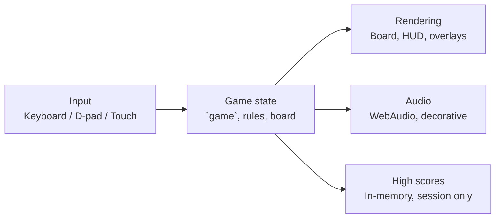

# Number Chomper

A playable, single-file web game. Move the Chomper around a 6×5 number grid and chomp only the numbers that match the rule at the top. Clear the board to advance to the next level.

<!--  -->
<!-- Capture: mid-play on desktop width — rule banner, non-zero score, a Gobbler visible, 2–3 eaten cells. See the staff review §5.1, asset 1. -->

## Description

Number Chomper is a browser math game with no build step, no backend, and no account. You are the Chomper. The board is a 6×5 grid of numbers. Each level shows one rule — Multiples, Factors, Primes, Greater/Less Than, or Even/Odd — and only the numbers matching that rule count. Chomp them all to clear the level, while three kinds of Gobblers move around the board trying to catch you.

Levels 1–5 cycle through the five rule kinds in order, so a new player meets each rule once before any repeats. From level 6, half of all levels re-roll a random rule, so later play is not a fixed rotation you can memorise.

High scores are kept for the current browser session only. There is no server, no account, and no saved data after you close the page.

## Prerequisites

- A modern web browser with JavaScript enabled, CSS Grid support, and WebAudio support. Any current Chrome, Firefox, Safari, or Edge works.
- No Node.js, no package manager, and no build tool are required to play or to edit the game.
- An internet connection is needed only for the Google Fonts used for the headline type (Press Start 2P and Nunito). Offline, the game still plays and falls back to system fonts.

## Installation

There is nothing to install.

```sh
git clone https://github.com/enonymous1/number-chomper.git
cd number-chomper
```

That gives you three files: `index.html` (the whole game), `README.md` (this file), and `LICENSE` (MIT). If you only want to play, you do not even need the clone — open the deployed site, or download `index.html` on its own and open it.

## Local Development

### Run it

Open `index.html` directly in a browser, or serve the folder (recommended if you are editing, so reloads behave the same as on Pages):

```sh
python3 -m http.server 8000
```

Then open http://localhost:8000/

### Edit it

The whole game is in `index.html`, in this order: styles, page markup, then one inline script with section banners (`Creatures`, `Audio`, `Rules`, `Game state`, `Rendering`, `Movement & chomping`, `Gobblers`, `Timer`, `Flow`, `High scores`, `Controls`).

Where to change what:

- **A rule:** `pickRule()` in the Rules section. A rule is a label, a `test` predicate, and two disjoint pools (`correctPool` / `wrongPool`). A value must never appear in both pools for the same rule.
- **Difficulty:** `gobblerCount()` and `gobblerSpeed()` — Gobbler count is `min(4, 1 + floor((level − 1) / 2))`, speed is `max(430, 1500 − 130 × (level − 1))` milliseconds per step.
- **Scoring:** `chomp()` and `levelClear()` — +10 per correct chomp, +5 at streak 5, stacking to +15 at streak 10 (25 per chomp at streak 10), and a level bonus of `100 + level × 10`.
- **A Gobbler:** `stepGobblers()` and `scribblerRewrite()`. Note the two invariants in the code: a Scribbler never rewrites away the last few correct cells (the `correctRemaining() <= 4` guard keeps every level winnable), and Gobblers spawn in shuffled corners away from the centre.
- **Look and feel:** the `<style>` block. Board size is 6 columns × 5 rows in both the CSS grid and the script's `COLS`/`ROWS` — change both together, or the creature positions (set by percentage) will desync from the grid.

### Check it

There are no automated tests yet. The checks before a commit are:

1. Extract the inline script and syntax-check it:

   ```sh
   python3 -c "import re, pathlib; t = pathlib.Path('index.html').read_text(); open('/tmp/chomper.js', 'w').write(re.search(r'<script>(.*)</script>', t, re.S).group(1))"
   node --check /tmp/chomper.js
   ```

2. Play through manually: start a game, chomp a correct number (score moves, +10 floats), chomp a wrong number (life lost, toast shows), let a Gobbler catch you (life lost, Chomper respawns invincible for 2.5 seconds), clear a level (bonus shown, Next Level works), and save a score on game over (name appears in the top-8 table, session only).

## How to Play

- **Goal:** chomp every number that matches the current rule, and nothing else. Clear them all to finish the level.
- **Lives:** you start with 3 Chompers. Chomping a wrong number, or letting a Gobbler catch you, costs one.
- **Levels:** clearing a board advances a level. Higher levels add more, faster Gobblers and larger numbers.

<!--  -->
<!-- Capture: 10–15 second loop at real play speed — move, chomp a correct number, build a streak, dodge a Gobbler. No audio, no speed-up. See the staff review §5.1, asset 2. -->

### Gobblers

- **Wanderer** — wanders the board, but is still hungry.
- **Scribbler** — rewrites numbers it steps on. It never rewrites away the last few correct cells, so a level stays winnable.
- **Hunter** — hunts you down, moving toward you most of the time.

<!--  -->
<!-- Capture: tight crop of the in-page Gobbler key — the three creatures side by side. See the staff review §5.1, asset 3. -->

## Controls

- Arrow keys / WASD — move
- Space — chomp
- P — pause (also pauses automatically when the tab hides)
- Touch — swipe the board to move, tap to chomp, or use the on-screen D-pad and CHOMP button

<!--  -->
<!-- Capture: phone width, D-pad and round CHOMP button visible, a Gobbler on the board. See the staff review §5.1, asset 4. -->

## Scoring

- +10 per correct chomp
- Streak bonus: +5 at a streak of 5, stacking to +15 at a streak of 10
- Clearing a level pays 100 + 10 per level

## Sound

Synthesized in-browser sound effects (WebAudio oscillators, no audio files), with a mute toggle in the HUD. Sound is decorative: if audio is unavailable or blocked, the game plays silently and nothing else changes.

## Architecture



The game is a single file by design: no build step, no modules, and no backend. That keeps "open `index.html` and play" true, including from `file://` (ES modules would break that in Chrome, which is why a future file split should use classic scripts, not modules — see the staff review).

The coupling to know about before editing: rendering reads the global `game` object directly, rules are an `if`-chain in `pickRule()` (each rule builds its label, predicate, and both pools together), and high scores are an in-memory array rendered straight to the DOM. A future `localStorage` score store, a new rule kind, or a second board size should go through the seams described in the staff review (a `CONFIG` object, a shared board builder, and a `ScoreStore` interface) rather than by adding more branches to the existing functions.

## Project Structure

```text
number-chomper/
├── index.html   # The whole game: styles, markup, and inline script
├── README.md    # This file
└── LICENSE      # MIT
```

Visual assets, when captured, live under `docs/images/` (see below) and are referenced from this README only.

## Testing

There is no automated test suite yet. The current verification is the syntax check and manual playthrough in Local Development above, plus a fresh-extraction HTTP smoke check (page serves 200 with the title "Number Chomper").

Planned, in order: a `node --check` CI job on the extracted script, then Node tests for the pure logic (prime testing, rule pools being disjoint, the Scribbler solvability guard) once that logic is extracted from the DOM code. A headless-browser smoke test is deferred until that extraction lands — testing the current global-state script through a DOM shim would mostly test the shim.

## Known Limitations

- High scores last for the current browser session only and reset when the page is closed.
- There is no saved progress, no account, and no multiplayer.
- Sound requires WebAudio; without it the game is silent.
- Google Fonts are fetched at runtime; offline play falls back to system fonts.
- Keyboard focus is not yet moved into overlays, and rule changes are not yet announced via `aria-live` — see the staff review for the accessibility follow-ups.

## Deployment

### GitHub Pages (branch deploy)

1. Push this repo to GitHub.
2. Settings → Pages → Build and deployment → Source: Deploy from a branch.
3. Branch: `main`, folder: `/ (root)`.
4. Save. The site will be served from `index.html` at `https://enonymous1.github.io/number-chomper/`.

Verify the deploy by opening that URL, pressing Start, and playing one level: the title screen, rule banner, and HUD should all render, and a correct chomp should move the score.

If the Pages site is blank, check in order: the branch and folder in Pages settings, that the file at the repo root is named exactly `index.html`, and that the push actually landed on `main` (a push to another branch will not deploy under branch settings).

<!--  -->
<!-- Capture only after the first real deploy: the deployed Pages site itself. Do not mock this. See the staff review §5.1, asset 6. -->

### Any static host

Because the game is a single static file with no build step, the same `index.html` can be served from any static host (Netlify Drop, Cloudflare Pages, an S3 bucket with static hosting, or a plain web server directory). No server-side code, environment variables, or build command are needed.

## Contributing

Small, focused changes are welcome: a new rule kind (with disjoint pools and a test for them), a difficulty tweak with the numbers stated, or an accessibility fix. Please keep the single-file, no-build scope unless a change proposes a file split as its own commit with a CI job — see Architecture above. Do not add screenshots, scores, or levels you did not actually play, and do not reintroduce the original game's trademarked names.

## License

MIT — see [LICENSE](LICENSE).
